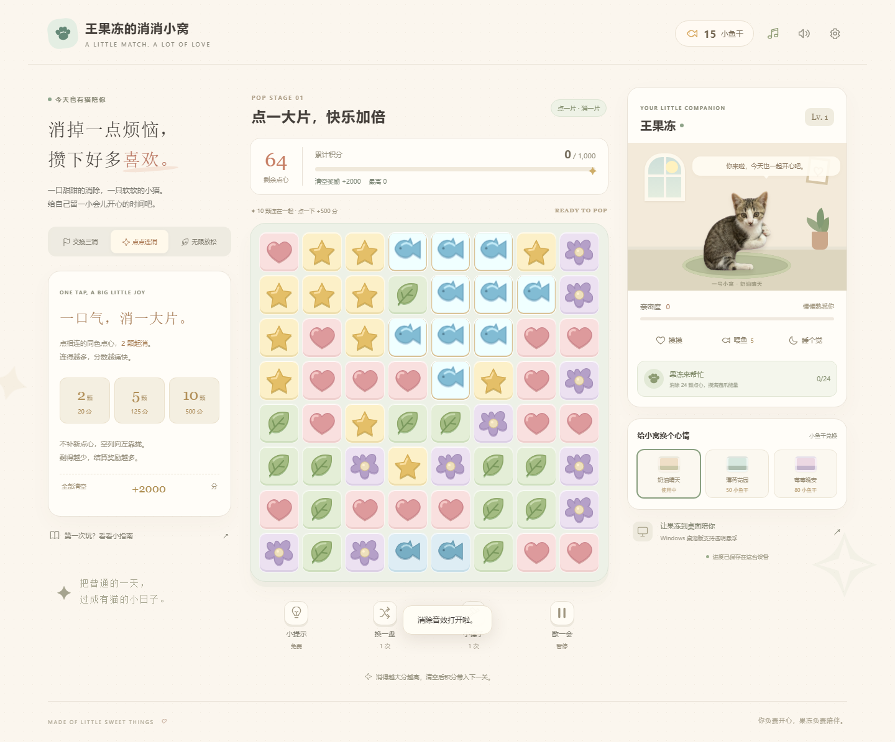

# 王果冻的消消小窝

一款温暖风格的原创消除小游戏，搭配一只会摸摸、喂鱼、睡觉的猫咪。支持离线网页与 Windows 透明桌宠。



## 玩法

- **交换三消：**12 个关卡，积分、收鱼、融冰目标。四连清行/列、五连彩虹星、T/L 形炸弹。
- **点点连消：**相邻同色 2 颗起消，得分为颗数平方乘 5；向下掉落、空列左移，不补新块。清空额外奖励 2000 分，累计积分带入下一关。
- **无限放松：**不限步数，没有倒计时。
- **特效组合：**直接点击特效引爆，或滑动两颗特效组合成十字风暴、范围爆破、彩虹特效。
- **猫咪陪伴：**消除赚小鱼干，喂猫、摸摸、换小窝；攒满猫爪能量清除全盘同色。
- **音乐与反馈：**原创程序生成的钢琴背景音乐、连消音效、碎片、光束、大分数与落地回弹。
- **本地保存：**自动保存棋盘与养成进度，可导出、导入 JSON 存档。

## 马上试玩

下载或克隆仓库后，双击根目录的 `开始游戏.html`。请保留完整 `dist` 目录。无需安装依赖、无需联网。

也可以启动静态服务器：

```powershell
python -m http.server 4188 --directory dist
```

打开 `http://localhost:4188`。首次点击后音乐开始，右上角 ♪ 和喇叭分别控制音乐、音效。

## 操作

| 操作 | 方法 |
| --- | --- |
| 交换三消 | 点击两颗相邻点心，或鼠标/手指滑动 |
| 点点连消 | 点击相连的同色点心，至少 2 颗 |
| 特效组合 | 把两颗特效滑动到一起 |
| 猫爪技能 | 消除 24 颗充满，点技能再选一种点心 |
| 小锤子 | 点按钮后点要敲掉的点心，每局 1 次 |
| 键盘 | 方向键选格，回车/空格操作，Esc 取消或暂停 |
| 摸猫/喂猫 | 每 3 秒摸摸可 +1 亲密度；5 条鱼可喂一次，亲密度 +8 |

提示免费；三消换盘免费，点点连消每关可以换盘一次。离线不会扣亲密度。

## Windows 桌宠版

发行版 ZIP 应从仓库的 **Releases** 获取，完整解压后双击 `王果冻的消消小窝.exe`。仓库保存源码，发行包单独提供。

本地打包需要 Windows、Python 3.12：

```powershell
python -m venv .venv
.\.venv\Scripts\python.exe -m pip install -r desktop\requirements.txt
.\desktop\build.ps1 -PythonExe .\.venv\Scripts\python.exe
```

构建结果位于 `.build/release/王果冻的消消小窝`。整个文件夹一起分发，不能只发送 EXE。构建脚本包含 Qt 与 Windows ICU 运行库冲突的修正。

桌宠可以左键拖动、点击摸摸、双击回到游戏；右键可喂猫、睡觉、隐藏或退出。关闭游戏窗口后桌宠继续留在桌面，完全退出请使用猫咪或托盘的右键菜单。

## 个性化与存档

编辑 `dist/config.js` 可修改猫名、默认称呼和通关纸条。已有存档的称呼以游戏设置中的值为准。

网页版保存到当前浏览器；Windows 版保存到 EXE 同目录的 `data/save.json`，上一份备份在 `data/save.backup.json`。切换浏览器、移动文件夹或换版本前，可以在设置中导出 JSON 存档，再到新版本导入。两个版本没有云同步。

## 源码结构

```text
开始游戏.html         离线网页入口
dist/                 网页源码及完整猫咪素材，需要提交
  engine.js           三消与点点连消规则
  app.js              界面、操作和存档
  audio.js            背景音乐及音效
  effects.js          消除粒子及光束
  config.js           可自定义内容
  assets/             猫咪素材
desktop/              PySide6 桌宠、网页窗口及打包脚本
tests/                规则测试
docs/                 玩法参考、验证记录和截图
```

`dist/` 在本项目中是直接维护的静态网页源码。Windows 运行环境、ZIP、虚拟环境、打包缓存、本地存档与密钥不提交到 Git。

## 验证

需要 Node.js 运行规则测试：

```powershell
npm test
npm run check
```

20 项规则测试、15 组浏览器检查和 4 组 Windows 程序检查通过，包含连片重力、清场奖励、音频信号、特效组合、手机布局及旧存档迁移。详见 [验证记录](docs/VALIDATION.md)。

玩法例子和设计选择见 [设计说明](docs/DESIGN.md)。
